  
  
  

## ⚡ `whoami`

  

> I'm a Computer Science engineer from Bengaluru who enjoys building **practical, secure web applications — increasingly with AI built in.** I graduated in **First Class with Distinction (CGPA 8.9)**, co-authored a paper in **IJRASET**, presented my final-year project at the **ICGCP-2026** international conference, and completed the **Bharat Unnati AI Fellowship**.

## 🛤️ My journey so far

## 🛠️ Tech I work with

  

<b>🔍 See it grouped by area</b>

 

| Area | Tools |
|---|---|
| 💻 Languages | Java · Python · SQL · JavaScript |
| 🌐 Web | React · Flask · REST APIs · HTML · CSS |
| 🤖 AI & Data | Generative AI · Gemini API · scikit-learn · NumPy |
| 🗄️ Databases | SQLite · MySQL |
| 🔐 Security & Tools | Git & GitHub · Linux · Google Cybersecurity Professional Certificate |

## 🧩 Things I've built

<table>
<tr>
<td width="50%" valign="top">

### 🛡️ NagrikSuraksha
⭐ <b>Featured</b> · Final-year team project · Presented at ICGCP-2026

Citizen safety & crime-reporting platform. I built the **Police Dashboard** — role-based admin/officer views, complaint assignment, SOS alerts with map locations, resolved-case tracking and a face-recognition search screen.

   

</td>
<td width="50%" valign="top">

### 💰 Personal Budget Tracker
🤖 <b>AI-powered</b> finance app

Multi-user finance app with **Gemini-powered natural-language & voice entry**, AI spending insights, and a **scikit-learn** model that auto-categorises transactions.

   

</td>
</tr>
<tr>
<td width="50%" valign="top">

### 📈 Stock Data Intelligence Dashboard
📊 Data & REST APIs

Calculates returns, moving averages, 52-week highs/lows and volatility, served through **REST APIs** to an interactive Chart.js dashboard.

   

</td>
<td width="50%" valign="top">

### 🍔 Dineva – Food Delivery Web App
📱 Responsive front end

Food-ordering app with restaurant menus, cart, checkout, order tracking and an admin dashboard — built for desktop and mobile.

  

</td>
</tr>
</table>

## 🌱 Right now

- 🔭 Working as a **Technical Operations Intern** at **Karix**
- 📚 Strengthening **Java & data structures** and learning **Spring Boot**
- 🤖 Exploring **practical automation** and building with **Generative AI**
- 💬 Ask me about **Flask, React, the Gemini API** or **secure web apps**

  
   
  LEARN · BUILD · SOLVE · GROW

