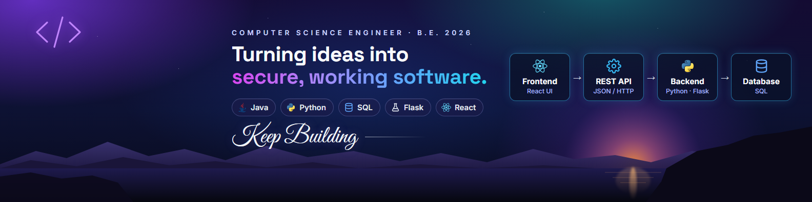

  

<h1 align="center">Hi 👋, I'm Aniket Vishnu</h1>

  

  
  
  

---

### 🚀 About me

- 🎓 **B.E. in Computer Science & Engineering** – Sapthagiri College of Engineering (VTU), 2026 · **CGPA 8.9** · First Class with Distinction
- 💼 **Technical Operations Intern** at **Karix** (Bengaluru)
- 🤖 Completed the **Bharat Unnati AI Fellowship** – a 4-month AI internship on Generative AI and agentic AI workflows
- 📄 Co-author of a survey on crime detection & prevention, published in **IJRASET (2025)**
- 🌱 Currently strengthening **Java & data structures**, learning **Spring Boot** and exploring practical automation
- 📍 Bengaluru, India

---

### 🛠️ Tech stack

  

| Area | Tools |
|---|---|
| 💻 Languages | Java · Python · SQL · JavaScript |
| 🌐 Web | React · Flask · REST APIs · HTML · CSS |
| 🤖 AI & Data | Generative AI · Gemini API · scikit-learn · NumPy |
| 🗄️ Databases | SQLite · MySQL |
| 🔐 Security & Tools | Git & GitHub · Linux · Google Cybersecurity Professional Certificate |

---

### 🧩 Featured projects

| Project | What it does | Built with |
|---|---|---|
| **🛡️ NagrikSuraksha**  Final-year team project | Citizen safety & crime-reporting platform. I built the **Police Dashboard** – role-based admin/officer views, complaint assignment, SOS alerts with map locations, resolved-case tracking and a face-recognition search screen. Presented at the **ICGCP-2026** international conference. | React · Node.js · SQLite · JWT · TOTP 2FA |
| **💰 Personal Budget Tracker** | Multi-user finance app with **AI features**: Gemini-powered natural-language & voice entry, AI spending insights, and a scikit-learn model that auto-categorises transactions. | Python · Flask · SQLite · Gemini API · scikit-learn |
| **📈 Stock Data Intelligence Dashboard** | Calculates returns, moving averages, 52-week highs/lows and volatility, served through REST APIs to an interactive dashboard. | Python · Flask · NumPy · Chart.js |
| **🍔 Dineva – Food Delivery Web App** | Responsive food-ordering app with menus, cart, checkout, order tracking and an admin dashboard. | JavaScript · HTML · CSS |

---

  
   
  LEARN · BUILD · SOLVE · GROW

